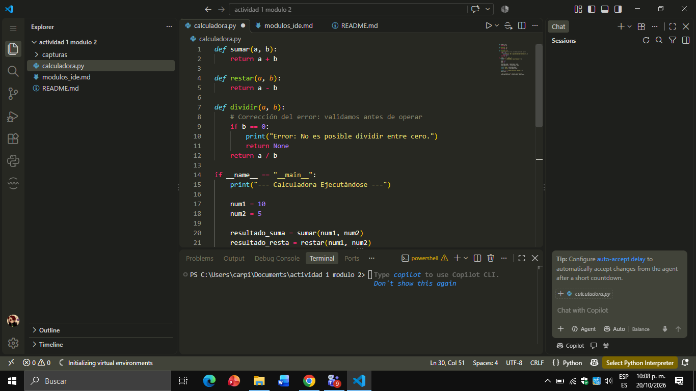
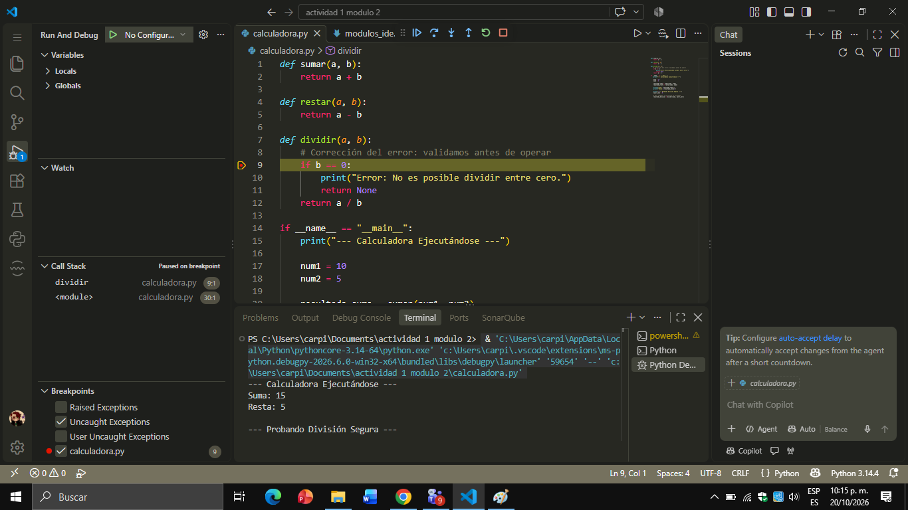

# Proyecto: Calculadora Básica en Python

Este proyecto consiste en una calculadora básica interactiva desarrollada en Python utilizando **Visual Studio Code** como entorno de desarrollo (IDE). El objetivo principal es demostrar el uso práctico de los módulos clave de un IDE y la correcta aplicación del control de versiones.

## Explicación del Uso de Módulos del IDE

En el desarrollo de este proyecto se interactuó con los siguientes componentes del entorno:

* **Editor de Código:** Se utilizó para escribir la lógica de las funciones de suma, resta y división. El resaltado de sintaxis permitió diferenciar estructuras lógicas clave, y el autocompletado agilizó la declaración de variables y llamadas a funciones.

* **Explorador de Archivos:** Permitió estructurar el proyecto de forma limpia, organizando el código fuente (`calculadora.py`), la documentación teórica (`modulos_ide.md`), el manual (`README.md`) y el directorio de evidencias visuales (`capturas/`).

* **Terminal Integrada:** Se utilizó para ejecutar directamente el script de Python dentro del entorno de trabajo mediante el comando de ejecución del IDE, visualizando los resultados en tiempo real sin salir de la interfaz.

* **Depurador (Debugger):** Se empleó para analizar el comportamiento del flujo lógico y comprobar el manejo de excepciones. Se colocaron *breakpoints* para inspeccionar los estados de las variables durante el flujo del programa.

## Manejo y Corrección de Errores

Durante el diseño de la función de división se identificó un riesgo de ejecución: el error lógico de **división por cero** (`ZeroDivisionError`). 

1. **Identificación:** Utilizando el depurador, se analizó el flujo cuando el segundo parámetro (`b`) tomaba un valor equivalente a cero.
2. **Corrección:** Se implementó una estructura condicional preventiva (`if b == 0:`) que valida el divisor antes de realizar la operación matemática. De esta forma, el programa no colapsa y devuelve una advertencia controlada en la terminal, asegurando la estabilidad del software.
